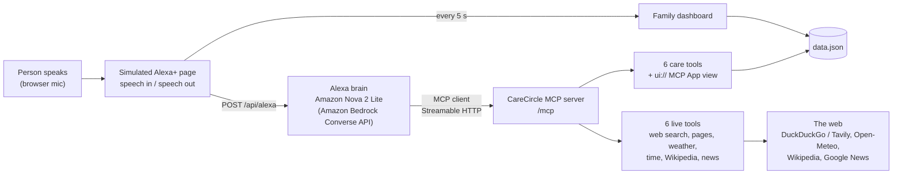

# CareCircle for Alexa+

**A caring, open-world voice assistant for families looking after a loved one.**

**Try it live:** https://carecircle-rm1e.onrender.com (use Chrome or Edge for voice; the first visit can take about 30 seconds to wake up)

Mom lives alone. Her children live in other cities. Every day they worry: *Did she take her pills? Is she okay?*
CareCircle is an Alexa+ add-on that answers those questions. Mom just talks to Alexa, and the whole family stays in the loop.
And because Alexa+ is a real assistant, CareCircle can also answer anything else: live weather, news, facts from the web, or a full explanation of a health condition.

Built for the **Alexa+ track** of the Build, Ship, Shape: Amazon Developer Hackathon, using a **simulated Alexa+ web app** (real Alexa+ add-ons are not yet available in India).

## What it does

| Say something like | What happens |
|---|---|
| "I took my pressure tablet" | Logs the dose (`log_medication`) |
| "Did Mom take her medicines today?" | Lists what's taken and what's missing (`check_medication_status`) |
| "Mom felt dizzy after lunch" | Saves a care note for the family (`add_care_note`) |
| "Mom fell in the bathroom" | Saves a note **and** alerts the family (`alert_family`) |
| "How was Mom's day?" | A short spoken summary written by Amazon Nova (`get_daily_summary`) |
| "Show me Mom's care screen" | Shows an Echo Show style screen, built as an **MCP App** (`show_care_dashboard`) |
| "What's the weather in Bengaluru?" | Live weather (`get_weather`) |
| "Who won the last IPL?" | Searches the whole web and reads pages for details (`search_web`, `read_webpage`) |
| "What's the news in India today?" | Latest headlines (`get_news`) |
| "What time is it in London?" | Live date and time (`get_current_time`) |
| "Tell me about Chandrayaan-3" | Facts from Wikipedia (`look_up_facts`) |
| "What is diabetes?" / "How can we prevent it?" | Answers any question in full, and remembers the conversation |

**Natural conversation:** tap **Start talking** once and just talk. Alexa waits for you to pause, then answers. You can interrupt her any time, even while she is speaking or thinking, and she listens and combines what you said. She also understands spelling mistakes and Indian English.

**Safe by design:** CareCircle gives general health information only. It never tells anyone to start, stop or change a medicine or dose, and it tells them to check with a doctor or pharmacist. For urgent symptoms (chest pain, trouble breathing, a fall) it says to call emergency services and alerts the family.

## How it works



1. The web page listens continuously with the browser's speech recognition, like an Echo device, and supports barge-in.
2. **Amazon Nova 2 Lite** on **Amazon Bedrock** (Converse API with tool calling) decides what to do.
3. Nova calls the **CareCircle MCP server** over **Streamable HTTP** (MCP spec 2025-11-25), exactly as Alexa+ would call an add-on.
4. The `show_care_dashboard` tool links to a `ui://carecircle/today.html` resource (**MCP Apps** extension, `text/html;profile=mcp-app`). The page shows it in a sandboxed frame, like an Echo Show.
5. Alexa speaks the answer, and the family dashboard updates.

## Tech

- **MCP:** `@modelcontextprotocol/sdk`, a stateless Streamable HTTP server, tools, and an MCP App resource
- **AWS:** Amazon Bedrock, Amazon Nova 2 Lite (`global.amazon.nova-2-lite-v1:0`), region `ap-southeast-2`
- **Live data:** DuckDuckGo or Tavily (web search), Open-Meteo (weather), Wikipedia, Google News RSS: no keys needed
- **App:** Node.js 24, Express 5, Zod, plain JavaScript, Web Speech API
- **Hosting:** Render, with per-visitor usage limits

## Run it

You need Node.js 24 and an Amazon Bedrock API key with access to Amazon Nova 2 Lite.

```bash
git clone https://github.com/Pratheeksh-7S/Carecircle.git
cd Carecircle
npm install
```

Set your Bedrock API key (never commit it):

```powershell
# Windows PowerShell
$env:AWS_BEARER_TOKEN_BEDROCK="your-key"
```
```bash
# macOS / Linux
export AWS_BEARER_TOKEN_BEDROCK="your-key"
```

Optional: `AWS_REGION` (default `ap-southeast-2`), `BEDROCK_MODEL_ID` (default `global.amazon.nova-2-lite-v1:0`), `TAVILY_API_KEY` (better web search; without it CareCircle uses DuckDuckGo), and `MAX_PER_HOUR` / `MAX_PER_DAY` (usage limits, default 30 and 500).

```bash
npm start
```

Open http://localhost:3000 in Chrome or Edge. The MCP endpoint is http://localhost:3000/mcp, so you can also connect any MCP client to it.

## Project structure

```
server.js            Express server: /mcp endpoint, /api/alexa, /api/dashboard, usage limits
src/mcp-server.js    CareCircle MCP server: care tools + MCP App resource
src/live-tools.js    Live tools: web search, web pages, weather, time, facts, news
src/care-view.js     The MCP App HTML view (Echo Show style screen)
src/alexa-brain.js   Simulated Alexa+: Amazon Nova + MCP client
src/bedrock.js       Amazon Bedrock client and model ID
src/care-data.js     Simple JSON storage for meds, doses, notes and alerts
public/              The simulated Echo web page (conversation mode, Aurora design)
```

## License

MIT